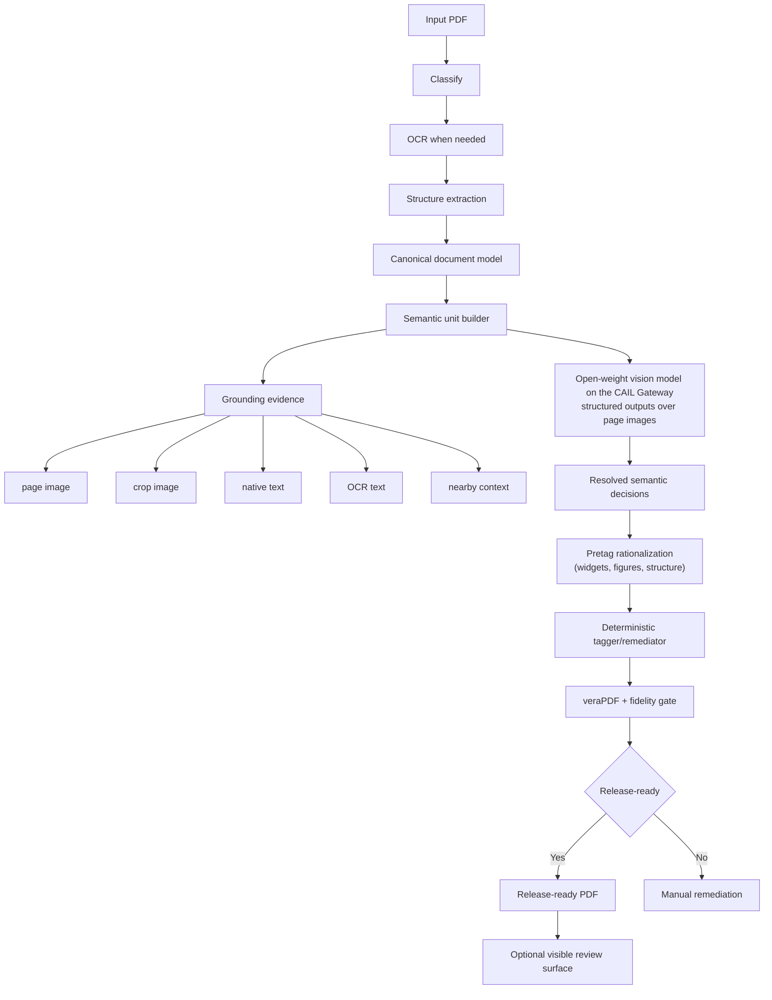
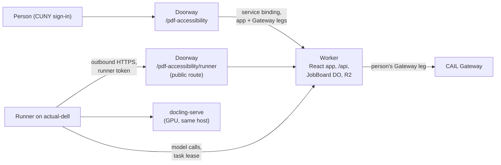

# Architecture

Updated: 2026-10-30

This app has two distinct layers:

1. semantic interpretation
2. deterministic PDF writing and release gating

That split is deliberate. A vision model is used where meaning is hard. The PDF writer stays deterministic.

The visible product model is also split cleanly:

1. release-ready output
2. manual remediation when trustworthiness is not high enough
3. optional advanced review only for human-legible visible output

## Runtime flow

## Session boundary

The deployed app is for signed-in CUNY people. Doorway signs them in, checks
Admission membership, and forwards signed identity tokens; the Worker verifies
them and scopes every job, file, and review route to the signed-in subject.
The runner on actual-dell runs each job's pipeline, and its model calls go
through the Worker with the signed-in person's Gateway credential (see
[Version 2](#version-2)). There are no anonymous sessions in the deployed app.

Local development uses the same Worker and runner through
`worker/dev/e2e.mjs`, with temporary signed identities and a dev Gateway
using a personal key. Docker runs the runner only; it serves no HTTP routes.

## Version 2

Version 2 runs the same pipeline behind CAIL Doorway. A Cloudflare Worker
(`worker/`, `cail-pdf-accessibility`) owns everything a person touches; the
pipeline host (`python -m app.runner`, on actual-dell) owns the PDF work.

- **Sign-in and ownership.** Doorway signs people in, checks Admission
  membership, and forwards two signed legs: the app's (audience
  `cail:pdf-accessibility`) and the Gateway's. The Worker verifies both;
  a job belongs to the signed-in subject. There are no anonymous sessions.
- **Jobs.** One SQLite Durable Object, `JobBoard`, holds every job, its
  steps, its task (process, review, or sync), and its lease, and enforces
  the per-person and global limits. R2 holds the input PDF and, for each
  revision of a job's result, the files the read routes serve.
- **Work.** The runner claims the oldest task (reviews and re-renders
  before new uploads), downloads the input or the job's saved state, runs
  v1's pipeline against a per-job SQLite file, reports each step, and
  uploads the views the routes serve, rendered by v1's response code. It
  keeps nothing between tasks.
- **Model calls.** The runner's model endpoint is the Worker's relay for
  that task; the task's lease is its credential. The Worker forwards each
  call to the Gateway with the person's own leg, so spend lands on the
  person's budget and the Gateway rechecks membership and quota on every
  call. A refused credential fails the job instead of being papered over.
- **Time.** Work is not queued when the person's Gateway leg has under an
  hour left. A task's deadline is the earlier of three hours and the leg's
  expiry; a lease lasts three minutes and is renewed by progress. A job
  whose runner goes quiet is retried once. Jobs and files are deleted 12
  hours after their last change.

The runner contract (paths, headers, payloads) is defined on both sides,
`worker/src/contract.ts` and `backend/app/runner/client.py`; change them
together. `worker/dev/e2e.mjs` runs the real Worker and runner on one PDF.

## Semantic units

The semantic layer no longer treats text, tables, forms, figures, and TOC candidates as unrelated flows. It normalizes them into local regions with shared evidence:

- page number
- bounding box
- kind candidate
- native text candidate
- OCR text candidate
- image crop
- nearby structure context
- confidence and provenance

Current semantic-unit families:

- suspicious text blocks
- reading-order pages
- tables
- forms
- figures
- TOC groups

## The model's role

An open-weight vision model, reached through the CAIL Gateway, is the semantic judge for hard units.

It decides things like:
- what assistive tech should hear for a garbled block
- which table rows are headers
- what a form field should be labeled
- whether a figure candidate is actually a figure, a table, or a form region
- whether a page region is a TOC group

The model is not allowed to write PDF objects directly.

## Deterministic layer

The deterministic layer is responsible for:

- pretag rationalization of suspicious widgets and under-described visual figures
- PDF/UA tag tree construction
- `/ActualText`
- form `/TU`
- artifacts
- bookmarks and TOC structure
- font remediation
- metadata
- final validation and fidelity gating

Main implementation files:

- [backend/app/pipeline/orchestrator.py](../backend/app/pipeline/orchestrator.py)
- [backend/app/pipeline/tagger.py](../backend/app/pipeline/tagger.py)
- [backend/app/pipeline/validator.py](../backend/app/pipeline/validator.py)
- [backend/app/pipeline/fidelity.py](../backend/app/pipeline/fidelity.py)

## Key services

### Canonical model
- [backend/app/services/document_intelligence_models.py](../backend/app/services/document_intelligence_models.py)
- [backend/app/services/document_intelligence.py](../backend/app/services/document_intelligence.py)

### Generic semantic adjudication
- [backend/app/services/semantic_units.py](../backend/app/services/semantic_units.py)
- [backend/app/services/intelligence_semantics.py](../backend/app/services/intelligence_semantics.py)

### Specialized wrappers over the shared semantic engine
- [backend/app/services/intelligence_pages.py](../backend/app/services/intelligence_pages.py)
- [backend/app/services/intelligence_tables.py](../backend/app/services/intelligence_tables.py)
- [backend/app/services/intelligence_forms.py](../backend/app/services/intelligence_forms.py)
- [backend/app/services/intelligence_figures.py](../backend/app/services/intelligence_figures.py)
- [backend/app/services/intelligence_toc.py](../backend/app/services/intelligence_toc.py)

### Shared LLM transport
- [backend/app/services/llm_client.py](../backend/app/services/llm_client.py)
- [backend/app/services/intelligence_llm_utils.py](../backend/app/services/intelligence_llm_utils.py)

## Transport choices

Every AI step uses one transport: chat completions at `LLM_BASE_URL`, the
CAIL Gateway, with an open-weight vision `LLM_MODEL`. The model sees rendered
page images and figure crops, never PDF files.

The decision rule is Docling-first:
- trust Docling-native title, language, hyperlink/widget metadata, and native TOC when present
- escalate to the model only when the extracted document evidence is missing, weak, or semantically ambiguous
- build Docling-derived ambiguity plans first so the model sees only unresolved units, not whole lanes

Important properties:
- `json_schema` structured output where the model supports it, `json_object` otherwise
- candidate-ID adjudication for bookmark and navigation decisions
- retry and timeout bounds
- audit-grade token and cost tracking

## Release gate

A document is release-ready only when all three are true:

1. `veraPDF` says compliant
2. fidelity says faithful enough
3. the run ends `complete`, not `manual_remediation`

Optional visible review items do not block release. Hidden structural blockers still do.

## Known limits

- complex tables still require stronger extraction or manual remediation in some cases
- visual WCAG issues such as contrast are not yet a first-class audit layer
- math support is conservative formula tagging plus speakable formula text, not rich equation semantics
- rich media remains partial
- semantic adjudication still depends on good local page/crop evidence
